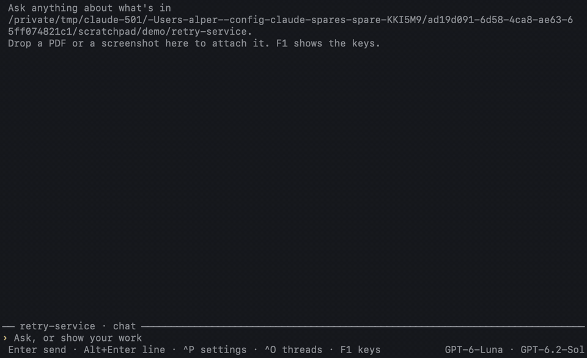

# Pathfinder

<br clear="left">

Pathfinder is a terminal app that makes sure you understand a task before an AI agent does it.

## How it differs from a coding agent

A coding agent does the work and explains afterwards. The explanation sounds right, you move on, and most of the time you can't judge if the result is right or how it works.

Pathfinder has its own agent, which edits your files, but only the parts you hand it explicitly. Designed to avoid the reasoning exposure from AI as much as possible.

- **Not a chatbot.** Ask a question and you get where your files or sources online address it. You do the reading and reasoning. `/tell` gives an answer when you want one. This is recorded as `told`.
- **Sharpen your judgement.** Explain something in your own words, then judge a short explanation that is either right or has one real mistake. This tracks your understanding.
- **Decide what the agent does for you.** Hand off a part you understand and review the result. Hand off one you don't, and the record is tracked either way.
- **An honest record.** `/why` shows what you proved, only claimed, or were told, so you know which parts you can vouch for.

> ### NOTICE
>
> This is *NOT* an autonomous coding agent. It asks more of you by design. The workflow is slow and requires patience, which is absent in today's most used agent harnesses.

### Demo


## Install

It's an invite-only [beta](docs/beta.md) that runs without an invite.

```sh
curl -fsSL https://pathfinder.lprsrts.com/install.sh | sh
```

## Start

```sh
pathfinder auth login     # ChatGPT plan, Anthropic or OpenAI key, or your own server
cd ~/path/to/your/work
pathfinder
```

Talk in plain language; commands are shortcuts. F1 shows the keys.

While you judge, a gate hides replies that would give the answer away. It needs a decision key (TypeSafe, OpenAI or Gemini) or the beta's shared one.

## Your data

Your messages and the files the model reads go to your model provider and decision service. Search terms go to OpenAlex, arXiv or Brave. My server sees update checks and, if you join the beta, your sign-in and what you choose to share. Nothing else leaves your computer ([privacy notice](https://pathfinder.lprsrts.com/privacy/)).

## More

- [Guide](docs/guide.md): a session, step by step
- [Reference](docs/reference.md): every command and setting
- [Theory](docs/theory.md): why it works this way
- [Beta](docs/beta.md), [contributing](CONTRIBUTING.md), [changelog](CHANGELOG.md), [security](SECURITY.md)
- License: [AGPL-3.0-or-later](LICENSE), parts adapted from OpenAI Codex ([NOTICE](NOTICE))
