# Pathfinder theory

*2026-11-24. This is the canonical theory. Prompts, critics and code follow from it. A feature that can't point to a section here doesn't belong, and a change to the theory is made here first.*

## 1. Purpose

Pathfinder is a human-in-the-loop harness. It makes sure you understand a task before the work is handed to an agent.

It is for all kinds of real work: coding, hardware, analysis, research, study and learning itself.

## 2. Understanding means you could judge the work

Understanding a task means you know what has to be done and why, well enough to:

- direct the agent, and
- tell whether its result is right.

You don't need to be able to do the work yourself.

## 3. The map

Onboarding sets the goal and sketches what the task depends on. That sketch is a rough map:

- It has no size limit. It is as big as the task needs.
- It grows and changes as the work reveals more.

## 4. You decide the split during the work

Which parts you do yourself and which go to the agent is not decided up front. It comes up during the related work, and you raise it. The model follows your call.

## 5. Evidence of understanding

Understanding is shown in three stages:

1. **Log.** While you work, you log your thinking and the reasons behind your steps and choices. This is where the evidence starts.
2. **Summary.** You explain the part as a summary.
3. **Candidate.** You're shown a candidate (an approach or a result) and judge whether it is right and why. This decides it.

## 6. Two kinds of skip

You can skip any part at any point. A skip is one of two kinds, recorded separately:

- **Already known.** Your word is enough. It is recorded as your claim, distinct from understanding shown through section 5.
- **Not understanding.** You hand the part off without understanding it, and you won't be able to judge its result.

## 7. Handoff and review

- After the agent does a part, you review its result. That's what understanding was for.
- When you find a problem, your objection and your reason go back to the agent, and you review again.

## 8. Record

These outcomes are kept distinct, in the session and, eventually, across sessions:

- understood (section 5),
- claimed as already known,
- handed off without understanding.

## 9. Why a harness

Sections 1–8 can be asked of any agent in plain words. An agent told to check your understanding is still the one that knows the answers, writes the record and does the work, so it can give the answer away, mark you as understanding, or act on what you can't judge, and nothing outside it would notice.

Pathfinder keeps these guarantees outside any model:

- what each model can see (section 11),
- what reaches you (section 11),
- what counts as evidence of your understanding (section 10),
- how the agent's work is labelled (section 12).

A model can propose; only the harness records. This is what Pathfinder adds to an agent, and what a set of instructions to an agent can't.

## 10. The understanding model

Pathfinder keeps a model of what you understand, finer than the map's parts:

- **Concepts** are the ideas the parts rest on, linked by what each needs first. Parts stay how you work through the task; concepts are what the record is made of.
- For each concept it keeps, separately:
  - your **claims** ("I know this"), as claims;
  - **evidence**: dated candidates you judged, with your reasons and whether you were right;
  - **misconceptions** your log or your judgments showed.
- Only evidence counts as understanding. A claim never becomes evidence, and a model's impression of your log ("seems to get it") is neither.

It is built as you work. Your log adds the concepts you touched and flags suspected misconceptions; your judgments add evidence. Only a failed judgment or a missed review demotes demonstrated understanding. Thinking out loud in your log never revokes it on its own, so you stay free to think candidly. Evidence ages: solid understanding cools over time and draws fresh checks rather than vouching forever. The model is kept across sessions (section 8).

It is used, not just kept:

- Candidates aim at what you most need to check: an open misconception, or a concept the part rests on that has no evidence yet.
- When a part rests on a concept you skipped or handed off, Pathfinder says so and the gap goes on the map.

## 11. What each model sees, and what reaches you

Some things must not reach you yet: whether a candidate is right and why, and an answer you are meant to produce yourself. These are kept from you in two ways:

- **Separation.** Each model is given only what its job needs. The model that answers your questions never sees a candidate's key. Models that hold a secret get no unnecessary tools, their reasoning is never shown to you, and a judge holds its reply until it confirms you gave a verdict.
- **A check on every reply.** Separation stops a model from leaking a stored secret, not from re-deriving an answer when you quote or paraphrase a candidate back to it. While a secret is active, a separate check inspects each draft before it reaches you, together with the turns since the secret opened, to catch multi-turn narrowing. If it reveals, hints at, or confirms the secret, the reply is written again without it.

Separation stops what a model never saw from leaking. The check catches what slips through or gets re-derived anyway.

## 12. Agent work and its provenance

Each change the agent makes is tied to the concepts it relies on, your rationale for the part (your summary and review objections), and the state of your understanding when it is made:

- **Reviewable**: every concept it relies on has evidence, so your review of it counts (section 7).
- **Claimed**: at least one concept rests only on your claim ("already known"), with none unknown, shaky or delegated. Kept distinct: never counted as vouched, and never conflated with handing off without understanding.
- **Delegated**: relies on an unknown, shaky, delegated or untagged concept, or was handed off without understanding (section 6), however carefully you look at it.

The labels are kept with the work, per file and per change (including deletions). Together they give **understanding coverage**: how much of the work you can vouch for, on what evidence, and why it was made. It is meant for you and for anyone who relies on the work, such as a supervisor or a reviewer, which is why the agent doing the work can't write it.

## 13. Checked review

Review can be as shallow as reading a diff and approving it. Pathfinder checks it the way a candidate checks a summary: now and then, the result you review contains a planted conceptual flaw in something the change relies on. If you approve it without catching the flaw, the review didn't happen and is not recorded as one. Objecting to a real bug in another part of the change goes back to the agent as usual and is never counted as a missed check.

Handoff runs in an isolated staging copy, and live diffs and prose summaries of the real edit are held back until your verdict, so neither the workspace, test output nor the agent's report gives away whether a review is checked. The planted flaw is revealed when you give your verdict, and only the agent's real result is written to disk.

## 14. Limits

- **The record is a map, not a grade.** The evidence behind every entry is visible, so you can see why the record says what it says and argue with it.
- **Understanding is not verification.** Vouching for a change means you understood the concepts behind it and reviewed it, not that it is free of runtime, integration or concurrency bugs. Automated tests and formal checks stay separate, and should be shown beside understanding coverage rather than conflated with it.
- **Tying work to concepts can be wrong.** You can see and correct it, and when it is unsure, or when later formatting breaks a hash, coverage is counted as lower, never higher.
- **Local integrity is not cryptographic proof.** The hash chain and tool boundaries keep the agent from altering the record (as far as command permissions and routes enforce them). Proving the record to an untrusting third party requires external signing.
- **Separation has a boundary.** Without the reply check (or on external CLI routes that keep their own transcripts), Pathfinder can mask history, but cannot stop a model from re-deriving an answer you paraphrase back to it.
- **Checks have a cost.** How often reviews are checked (section 13) is a visible setting of the session. A check you can't see is not allowed.

---

# Part II. Architecture

*Part II draws how Part I is built. Each diagram names the sections it serves; an element that can't is removed. When the two disagree, Part I wins.*

Legend for all diagrams: **solid** arrows carry ordinary data, **thick** arrows are writes only the harness makes (§9), **dotted** arrows carry a secret (§11). Decision models return probabilities and never text, so they can be shown a secret safely.

## A1. The whole system

*§9: models propose, the harness records. §11: who can see a secret.*

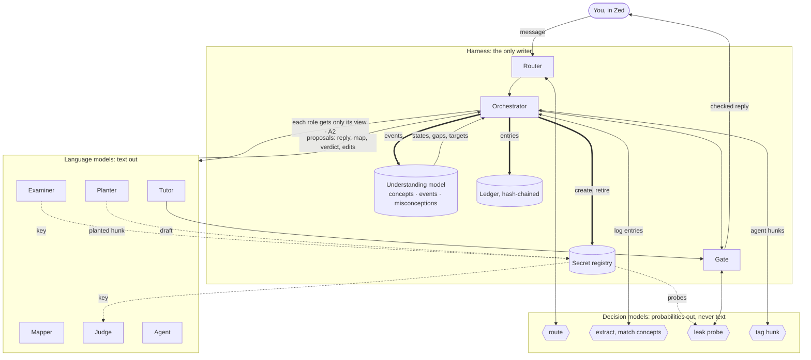

## A2. What each role may see

*§11: least view. The type system enforces it: a secret is a `Secret<T>` with no `Display` or `Serialize`, and only the views marked ● can turn it into prompt text.*

| Role | Kind | Tools | Map, log | Concept states | Candidate text | Key ● | Planted hunk ● | Returns |
|---|---|---|:-:|:-:|:-:|:-:|:-:|---|
| Router | decision | none | ✓ | | ✓ | | | step, part |
| Tutor | language | read-only | ✓ | ✓ | masked | | | reply, map change |
| Extractor | decision+language | none | ✓ | ✓ | | | | concepts, misconceptions |
| Mapper | language | read-only | ✓ | ✓ | | | | parts, concepts, prerequisites |
| Examiner | language | read-only | part only | targets | writes it | writes it | | candidate, key |
| Judge | language | none | part only | targets | ✓ | ✓ | ✓ | pass, misconception, feedback |
| Gate | decision | none | recent turns | | | probe | probe | p per secret |
| Agent | language | full (staging on handoff) | part only | | | | | changes, report |
| Tagger | decision | none | part only | | | | | concepts, p |
| Planter | language | none | one hunk | | | | writes it | flawed hunk |

The Agent never sees concept states or the ledger, so it can't shape its work to look reviewable (§12). Judge runs with no workspace tools, so untrusted files can't inject into a secret-bearing prompt, and buffers its reply until it confirms the message is a verdict. Thinking from Examiner, Judge and Planter is dropped at the sink by role (§11). Strict secret isolation holds on API routes; external CLI routes keep their own transcripts and sandboxes (§14).

## A3. A turn

*§4–§7: every message becomes one step; writes happen once, at the end.*

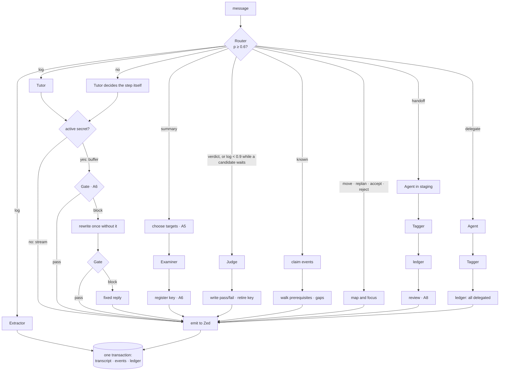

## A4. Data model

*§8, §10, §12. `events` is append-only; every state shown to you is computed from it.*

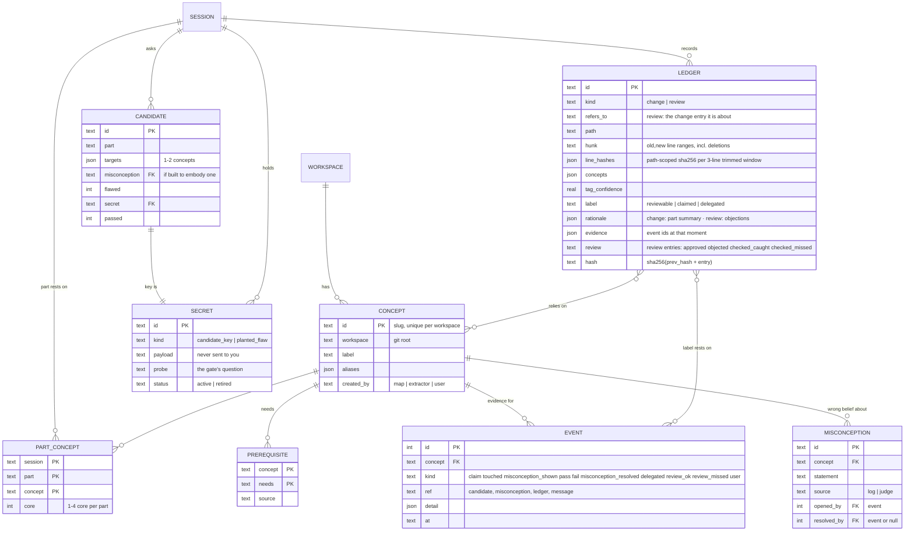

## A5. The understanding model's rules

*§10: only evidence counts. A concept's state, from its events:*

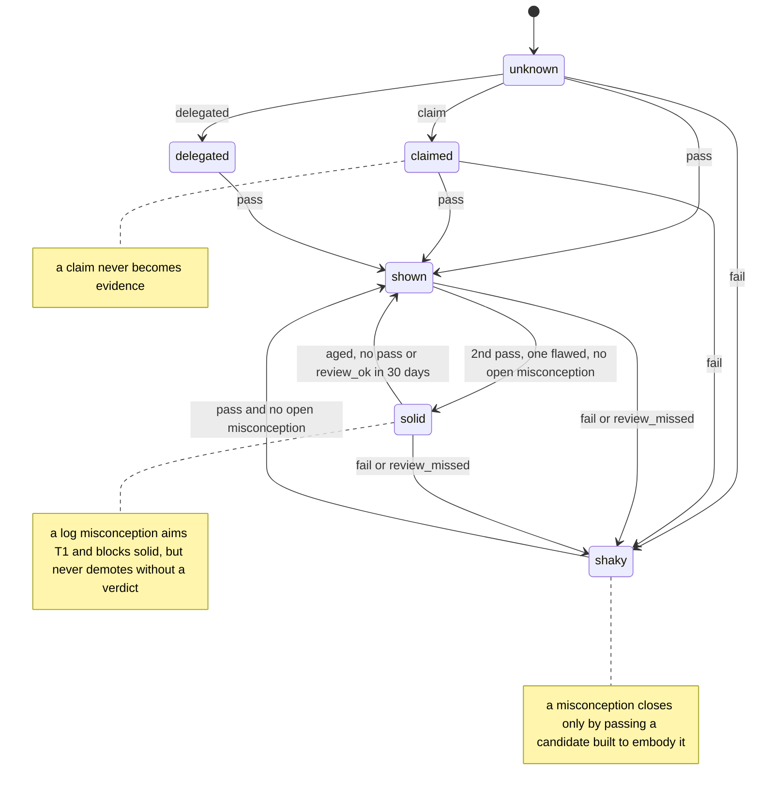

Ageing makes a state depend on time as well as events: states are computed as of a `now`, and anything that rests on a state (a ledger label, `/why`) stores the `now` it used, so it can be recomputed.

*A part's status, from its 1–4 core concepts:*

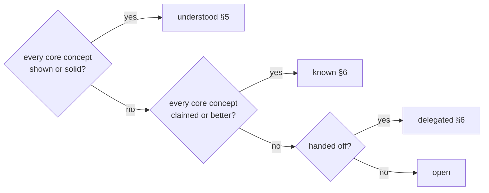

*What the next candidate checks, first match wins:*

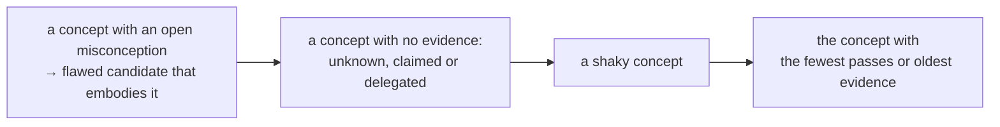

*Gaps, checked on entering a part and after every claim or handoff:*

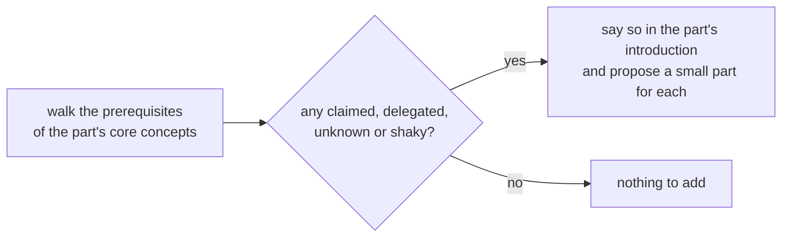

All three are computed by the harness, never by a model.

Concept matching: lexical and semantic candidates (slug, label, aliases and local embedding similarity, up to 20), then a decision choice "same as which, or new?"; same at p ≥ 0.7. Misconceptions from your log open only when a decision predicate "does this message state that belief?" reaches p ≥ 0.8; they aim the next candidate (T1) and block promotion to `solid`, but do not demote `shown` or `solid` until a verdict fails.

## A6. Secrets and the gate

*§11: separation first, then a check on every reply while a secret is active.*

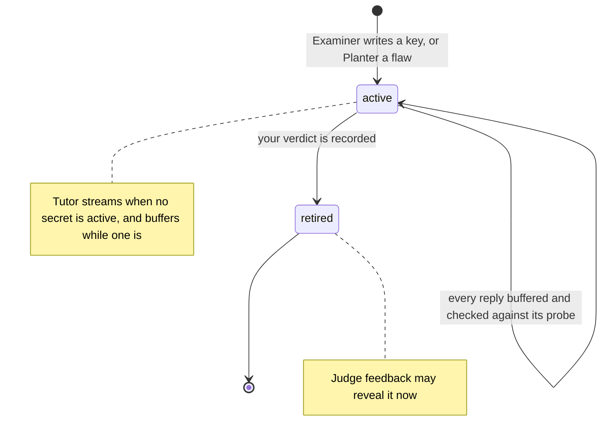

```mermaid
sequenceDiagram
    participant T as Tutor
    participant O as Orchestrator
    participant D as Decision model
    participant U as You
    T->>O: buffered draft reply
    O->>O: deterministic pre-check (code, hunk or symbol overlap)
    O->>D: one request: recent turns since secret opened + draft + a predicate per active secret
    D-->>O: p per secret
    opt some p in [0.15, 0.5)
        O->>D: key-blind reader: candidate + turns since it opened + draft
        D-->>O: P(right), P(flawed), P(neither)
        O->>O: bits toward the true key = log₂(q / 0.5), q = P(true) + ½·P(neither)
    end
    alt pre-check clear, all p < 0.5, and every p ≥ 0.15 moves the reader less than its stakes allow
        O->>U: reply
    else pre-check hit, any p ≥ 0.5, or over the stakes' bits (candidate 0.2 = 57.5% guessing odds, review check 0.14 = 55%)
        O->>T: rewrite without judging, hinting at, or resolving the pending check (never the probe or secret)
        T->>O: second draft
        O->>O: deterministic pre-check
        O->>D: check again
        alt passes
            O->>U: reply
        else blocked
            O->>U: fixed reply: "that's what the candidate is testing"
        end
    end
    Note over O,D: a check or reader that errors withholds the reply (fail closed).<br/>The reader judges mostly the last reply, so bits don't add up across a conversation reliably; the predicate still counts hints spread across turns.<br/>Judge buffers feedback until verdict is confirmed.<br/>No decision service: masked-history mode, shown in the toolbar (cannot stop paraphrase re-derivation).
```

## A7. Provenance and understanding coverage

*§12: every agent change is labelled by your evidence when it's made; coverage is computed from the ledger, never written by the agent.*

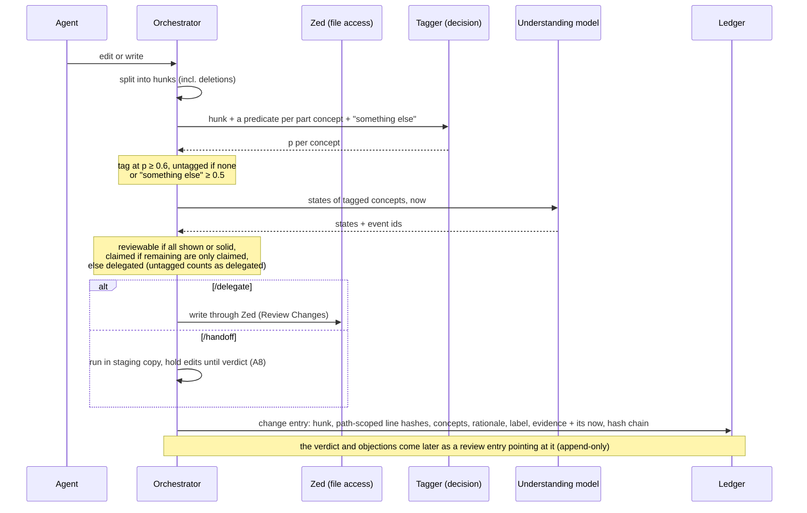

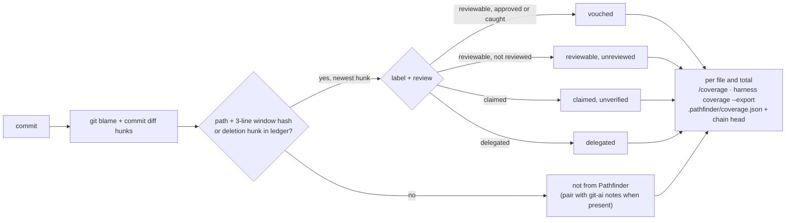

Each non-trivial added line is hashed with its file path and its nearest non-blank neighbours above and below (a path-scoped 3-line trimmed window), and deletion-only hunks are recorded at the commit/hunk level. Blank lines, trivial syntax-only lines (such as lone braces or delimiters) and lines already in the base commit are left out; later reformatting that breaks a hash fails closed to `not from Pathfinder`, never falsely vouching. When `git-ai` notes (`refs/notes/ai`) are present, coverage pairs with them so external AI edits are not conflated with human code, and test/command results are reported beside understanding coverage without merging the two (§14). The Agent's tools refuse to write under `.pathfinder/` or the session database. This hunk/git pipeline is the provenance backend for code; non-code work (§1) records provenance at the part and artifact level.

## A8. Checked review

*§13: handoff runs in an isolated staging copy until your verdict; now and then the review you see contains a planted conceptual flaw, and only the real result is written to disk.*

```mermaid
sequenceDiagram
    participant AG as Agent
    participant O as Orchestrator
    participant P as Planter
    participant D as Decision model
    participant U as You
    participant J as Judge
    participant Z as Zed (file access)
    AG->>O: handoff finishes in staging copy (live diffs & report held)
    O->>O: check this review? Off 0 · Light 0.15 shown / 0.05 solid · Normal 0.25 / 0.15
    opt checked
        O->>P: one reviewable hunk + its concepts
        P-->>O: plausible flawed version
        O->>O: syntax/build check passes in staging?
        O->>D: does it change the behaviour the part is about?
        D-->>O: p (keep if it builds and p ≥ 0.7, else retry once, else skip the check)
        O->>O: register planted hunk as a secret
    end
    O->>U: review in the thread: hunks as diffs (one planted if checked, no report contradicting it)
    alt /object on a checked review
        U->>J: objection
        alt names the planted flaw
            J-->>O: caught → review_ok on its concepts
            O->>Z: write real edits through Zed (Review Changes)
        else names a real issue on another hunk
            J-->>O: real objection (retire planted secret, not review_missed)
            O->>AG: send objection back to agent in staging
        end
    else /object on an unchecked review
        O->>AG: send objection back to agent in staging (§7)
    else /approve on a checked review
        O->>U: reveal planted vs real
        O->>O: review_missed → concept shaky, not recorded as reviewed
        O->>Z: write real edits through Zed (Review Changes)
    else /approve on an unchecked review
        O->>O: recorded as approved
        O->>Z: write real edits through Zed (Review Changes)
    end
    Note over O,U: Never on /delegate (§6). Real edits reach disk only after verdict.<br/>During /handoff the agent's commands still run in Zed's terminal (in the staging copy);<br/>its diffs appear only in the review. Live diffs stay a /delegate feature.
```

## A9. Building it from today's code

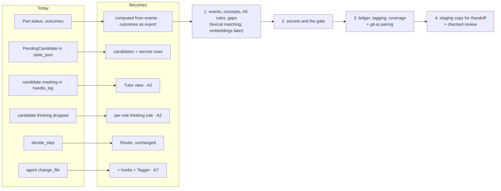

## A10. How we know it works

Run against recorded transcripts and scripted students before each release:

- **Leak rate**: replies a fresh decision model, given the key, judges to reveal it, tested against adversarial pressure transcripts (frustrated user, paraphrasing the candidate back to Tutor, multi-turn narrowing). Target: none sent.
- **Candidate discrimination**: candidates must separate students who later pass from guessing.
- **Check stealth & fairness**: planted flaws parse/compile cleanly, are never contradicted by live diffs or agent reports, and objections to real bugs are never scored as `review_missed`.
- **Evidence ratio**: `pass` over `claim` events per part, shown by `/why`, not a target.
- **Tagging soundness**: hand-tagged sample vs the Tagger, code and non-code work; no unsafe miss (a hunk tagged with some concepts but missing one it needs, so an approval could vouch for an idea you never showed). Untagged hunks are `delegated` and extra tags only undercount, so precision is reported, not a target.
- **Coverage soundness**: no line counted as `vouched` without ledger evidence whose chain verifies, and no `claimed` line counted as `vouched`.
